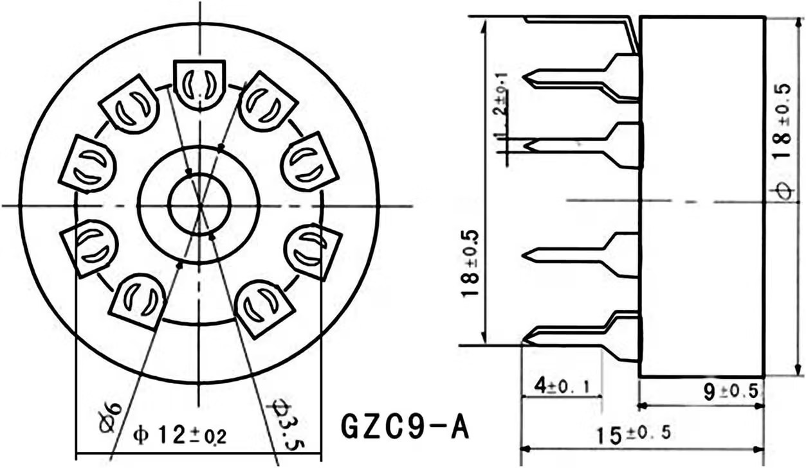

# GZC9-A socket dimensions

The owner supplied this drawing on 2026-09-21 for the ordered [Amazon B0BGBJ7L41 sockets](https://www.amazon.com/dp/B0BGBJ7L41). The [original JPEG](../datasheets/GZC9-A_socket-dimensions.jpg) is archived unchanged, with its original filename, receipt date and SHA-256 hash in [the source index](../datasheets/sources.json). The drawing identifies the part as GZC9-A but gives no manufacturer or revision.

## Dimensions shown

Dimensions below are interpreted in millimetres, consistent with the project plan. The image itself has no unit note. Values are transcribed from callouts, not measured from image pixels.

| Feature | Drawing callout | Use / interpretation |
|---|---|---|
| Socket body outside diameter | 18 ±0.5 | Allow up to 18.5 mm for the body before placement clearance. |
| Body axial depth | 9 ±0.5 | Body envelope above its rear face; installed height also depends on seating. |
| Overall axial length, including terminals | 15 ±0.5 | Nominal terminal projection is 6 mm beyond the body. |
| Contact circle in the face view | Ø12 ±0.2 | Tube-contact pattern; the side view shows the terminals bending outward. |
| Terminal span in the side view | 18 ±0.5 | The left-side dimension across the projected terminals; it is not explicitly labelled as a PCB pitch-circle diameter. |
| Narrow terminal section, visible width | 2 ±0.1 | One cross-section dimension; the perpendicular metal thickness is not supplied. |
| Straight end section of a terminal | 4 ±0.1 | Axial length of the narrow section. |
| Two central circular features | Ø6 and Ø3.5 | Neither callout establishes a required PCB hole. |

The nominal projection follows from 15 − 9 = 6 mm. Taking the two stated tolerances independently gives 5–7 mm; this is a conservative envelope calculation, not a separately specified seating dimension. Keep the space below the socket clear of components until its seating and PCB thickness are resolved.

## Footprint consequences

The drawing now supports the socket body envelope and axial clearance planning. The approximately 19.94 mm maximum tube glass diameter from the RCA document remains larger than the maximum socket body, so tube spacing must also accommodate the glass.

The face view depicts nine contacts with a larger indexing gap. It supplies no pin numbers, angular dimensions, view-direction label, or bottom-view PCB hole coordinates. The side view shows splayed terminals. Do not turn the Ø12 contact circle into the PCB drilling circle, or silently reinterpret the 18 mm side-view span as a fully specified pitch circle.

Before assigning a production footprint, confirm on an ordered sample:

- The narrow terminal cross-section: the drawing gives 2 ±0.1 mm in one direction; measure the perpendicular thickness to size the finished hole or slot.
- The terminal centres where they enter the PCB, including their relation to the indexing gap. Confirm the interpretation of the side-view 18 mm span and the seating depth.
- Any molded pin-1 mark or numbering, then the contact-to-tail mapping and viewing direction. Use that mapping to orient the numbered KiCad pads.

These are the remaining socket checks; the drawing replaces the earlier request for basic body dimensions. The schematic's V1–V4 footprints remain unassigned pending these checks. The tube's prefix-decimal pin verification is a separate electrical check.
